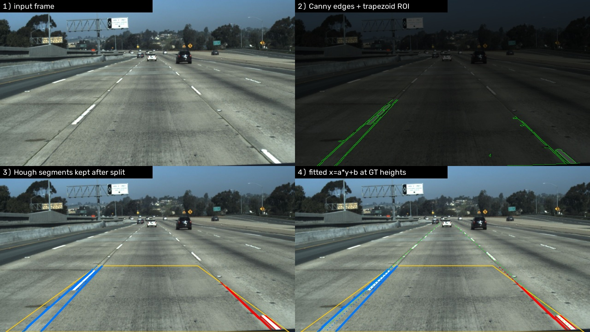
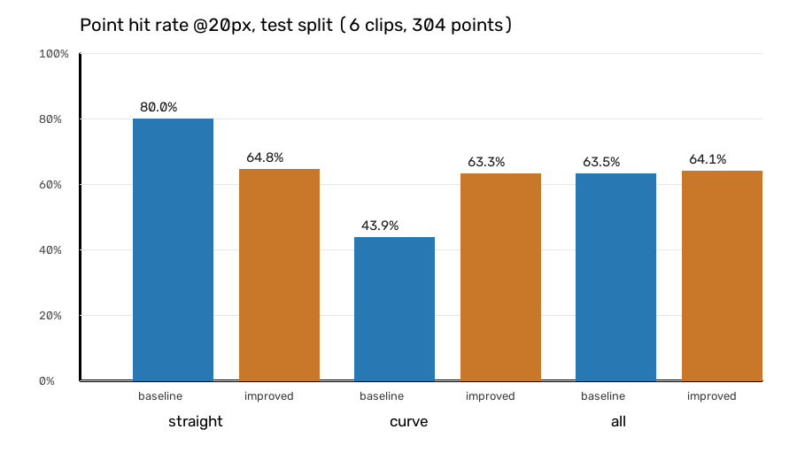

# 车道线检测实验：从 Hough 直线到 BEV 滑窗二次拟合

基于 TuSimple 公开标注数据的离线车道线检测对照实验。三轮迭代，每轮都有可验收的产物：
单帧坐标 → 评测表 → 只改一处的对照实验与两例误差分析。

> 目标不是"做一个能跑的车道检测 demo"，而是回答一个可被追问的问题：
> **在同样的边缘提取下，把直线拟合换成滑窗 + 二次曲线，究竟改善了哪一类场景、又牺牲了什么？**

## 1. 数据与切分

- 数据集：TuSimple Lane Detection（前视相机，1280×720，标注为若干固定 y 高度上的车道线 x 坐标）。
- 本轮取 8 个片段（每个片段 20 帧，仅第 20 帧有标注——TuSimple 每个片段只标 1 帧）：
  - 调参：2 个片段（1 直道 + 1 弯道）
  - 测试：6 个片段（3 直道 + 3 弯道），测试集固定，调参后不再改动
- 评测只统计 ROI 覆盖的 y 区间（y ≥ 432），ROI 以上属外推，不计入误差。
- 有效标注点：测试集 304 个（左 155 / 右 149），调参集 106 个。

场景按标注曲率分类：`|a|·span² < 40` 记为直道，`≥ 150` 记为弯道（二次拟合的曲率代理量）。
片段清单见 `data/selected.json`，重新下载数据用 `python scripts/fetch_sample.py`。

## 2. 环境

```
Python 3.13.14
opencv-python 5.1.0
numpy 2.5.5
Windows 11 (10.0.26100), Intel64
```

安装与运行：

```bash
python -m venv .venv
.\.venv\Scripts\python.exe -m pip install -r requirements.txt
python scripts/fetch_sample.py                  # 拉取 8 个片段 + 3 个标注文件
python src/baseline.py  --image data/raw/clips/0313-2/11520/20.jpg --labels data/labels/label_data_0313.json
python src/evaluate.py  --selected data/selected.json --out results
python src/make_figures.py
```

## 3. 第一次：两小时跑通一帧

链路（`src/baseline.py`）：

1. 读帧 → 灰度 → 高斯滤波（5×5）→ Canny（50/150）
2. 保留下半部梯形 ROI（底边 2%–98%，上边 33%–67%，上边高度 0.60H）
3. `cv2.HoughLinesP`（threshold 30，minLineLength 25，maxLineGap 100）
4. 按 `dx/dy` 符号分左右，再按"线段外推到画面底部的 x"聚类，取最靠近画面中心的一簇（广角相机下同侧会出现多条平行车道线）
5. 最小二乘拟合 `x = a·y + b`；某侧线段 < 2 条或总长 < 60 px 记为该侧漏检
6. 在标注给定的 y 上算预测 x，存 JSON + 叠加图

单帧输出（`results/baseline/preds/11520_20.json`）：

```json
{"pred_left": [629.2, 618.1, ...], "pred_right": [706.8, 717.9, ...],
 "steps": {"canny_edges": 21358, "roi_edges": 3904, "hough_segments": 29,
           "left_segments": 12, "right_segments": 8,
           "left_fit": [-1.03844, 878.08], "right_fit": [1.09594, 406.59]}}
```



**验收**：一帧的左右坐标已落盘；四步各用了什么信息可以从 `steps` 字段逐项对上。
**第一次就暴露的问题**：广角相机下 ROI 太窄会在 y≈640 处切掉右侧车道线（早期版本右侧整侧漏检），
把 ROI 放宽并加入"同侧聚类"后才稳定。

## 4. 第二次：把"看起来有效"变成数据

指标（`src/evaluate.py`）：

- 横向误差 `|pred_x − gt_x|`，容差 **20 px**（原始分辨率）
- 点命中率 = 容差内点数 / 全部有效标注点；**整侧漏检时该侧所有点计入分母**
- 单帧耗时：预热后重复 3 次取中位数；环境写入 `results/env.json`

测试集（6 片段 / 304 点）：

| 方法 | 直道命中率 | 弯道命中率 | 总体 | MAE | 单帧耗时 |
|---|---|---|---|---|---|
| baseline（Hough + 直线） | **80.0%** | 43.9% | 63.5% | 18.6 px | 6.8 ms |
| improved（BEV 滑窗 + 二次） | 64.8% | **63.3%** | **64.1%** | **16.2 px** | 10.6 ms |



调参集（2 片段 / 106 点）：baseline 55.7%，improved 36.8%。
改进版在调参集上同样更差，说明这不是参数调过头，而是方法本身在磨损/阴影场景下的脆弱性。

## 5. 第三次：只改一处

**改的是什么**：边缘提取（灰度、滤波、Canny、ROI）与基线逐字节相同，只替换拟合阶段：
把 `x = a·y + b` 换成"透视变换到鸟瞰图（BEV）→ 自底向上滑窗取点 → 二次拟合 `x = a·y² + b·y + c`
→ 反投影回原图"。BEV 单应矩阵由固定相机标定近似（`BEV_SRC`/`BEV_DST`），
滑窗 9 个、半宽 45 px，最后用标记线两侧边缘的 5%–95% 分位中点做一次再居中。

### 5.1 一例改善：0531 右弯（阴影 + 强光）

| | 左线 | 右线 | 总体 |
|---|---|---|---|
| baseline | 0%（漏检） | 0%（漏检） | 0% |
| improved | 0% | **100%** | 50% |

baseline 在该帧左右都拟合失败（Hough 线段不足）；BEV 滑窗把右侧实线完整取到，
误差 7.3 px。左侧仍失败：弯道内侧的实线被阴影切断，滑窗在 ROI 顶部取不到足够像素。

### 5.2 一例仍失败：0313-2/11520 直道（磨损标记）

| | 左线 | 右线 | 总体 |
|---|---|---|---|
| baseline | 92.6% | 74.1% | 83.3% |
| improved | **0%** | 40.7% | 20.4% |

失败机制：BEV 下左侧磨损白线的外边缘几乎消失，Canny 只剩内边缘，滑窗把这条内边缘当成线，
反投影后整条左线向车道内侧偏移约 25–40 px，超过 20 px 容差后全部判错。
baseline 用 Hough 线段端点做最小二乘，两侧边缘的线段都有贡献，反而被平均回标记中心。

### 5.3 结论（可以写"没提升"）

- **弯道：+19.4 个百分点**（43.9% → 63.3%），二次项确实能贴住弯曲边界。
- **直道：−15.2 个百分点**（80.0% → 64.8%），二次项的额外自由度放大了"单边缘/阴影边缘"造成的系统偏差。
- **总体：+0.6 个百分点**，在 304 个点的样本量下不构成显著优势；耗时接近 1.8 倍。
- 因此这一轮的正确结论是：**二次拟合只在"标记清晰且弯曲"时成立；它不是免费的改进**。
  下一步要么在 BEV 里做"双边缘配对"（同时取标记两侧边缘再取中），要么保留直线拟合、只对弯道做门控切换。

## 6. 目录

```
lane-perception/
├─ src/
│  ├─ lane_lib.py       # 预处理、Hough、聚类、直线/二次拟合、BEV、指标、绘图
│  ├─ baseline.py       # 第一次：单帧 + 每步日志
│  ├─ improved.py       # 第三次：BEV 滑窗 + 二次拟合（含可靠性回退）
│  ├─ evaluate.py       # 第二次：批量评测、CSV、耗时
│  └─ make_figures.py   # 流程图 / 柱状图 / 案例图
├─ scripts/fetch_sample.py
├─ data/selected.json   # 8 个片段、角色、曲率
├─ results/
│  ├─ per_frame.csv     # 16 行：8 帧 × 2 方法
│  ├─ summary.csv       # 分 split / 场景汇总
│  ├─ env.json
│  ├─ baseline/ improved/   # 叠加图 + 预测 JSON
│  └─ figures/
└─ README.md
```

## 7. 面试三分钟讲法

1. **问题**：直线拟合在弯道上系统性欠拟合，测试集弯道命中率只有 43.9%。
2. **改动**：只改拟合阶段——BEV 滑窗取点 + 二次曲线，边缘提取一行没动，保证对照干净。
3. **验证**：固定 6 个测试片段、固定 20 px 容差，逐点算命中率；弯道 43.9%→63.3%，直道 80.0%→64.8%，总体 63.5%→64.1%。
4. **解释**：二次项在弯道有效，但在磨损/阴影标记上会把"单边缘"当成线，产生 25–40 px 系统偏移；直线拟合的强先验反而更稳。
5. **局限**：测试集只有 6 个片段（TuSimple 每片段仅 1 帧标注），304 个点，结论只能说明趋势；下一步做双边缘配对与弯道门控。

## 8. 数据来源与许可

TuSimple 数据集仅用于学术研究，仓库不重新分发图像；`scripts/fetch_sample.py` 从公开镜像按需下载，
标注文件同样在脚本中获取。若用于发表或商用，请遵守 TuSimple 官方条款。
